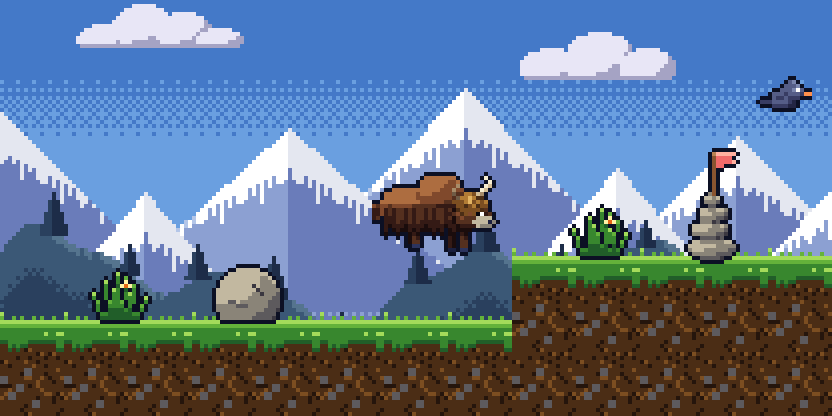

<p align="center"></p>

# Pixel Yak

**A pixel-art game studio you run with your AI.**

Your AI writes the game: the code, the pixel art, the music, all of it as code. You play it, paint
over the art, tune the music and the feel, and say what you think. Every edit you make becomes a
lesson the AI learns your taste from, so the next asset needs less of your time.

Pixel Yak isn't an AI and doesn't call one. It's a **harness**: a folder your AI works in (Claude
Code, Codex, Gemini CLI, Antigravity, Zed, anything that reads `AGENTS.md`). Inside it are a
desktop studio for *you*, a command line for *the AI*, a small game engine, a library of design
files, and skills that teach the AI how to work with you.

## What it's like
- **Art.** Every sprite of your game is in the studio. Paint over any frame; the running game
  updates instantly. Your pixels are an overlay the AI never overwrites, and each save is a lesson.
- **Sound.** Songs are shown as rows of notes. Change notes, instruments and tempo; hum a melody or
  bring in a MIDI file. Your changes become lessons too.
- **F9: "talk about this moment".** Press it in any game: a screenshot, the last few seconds, the
  game's state and a save of that exact moment go to the AI with your note.
- **F8: try the alternatives.** When "better" is hard to put into words, the AI builds 2–4 versions
  of a thing (a speed, a song, an art variant) behind a pixel-art panel. You flip between them
  while playing and keep the one that feels right.
- **Brief me first.** The AI summarizes each of your tickets and what it will change, and waits for
  your notes before touching anything.
- **Design files.** Art, sound and game design files to start a game from. Each game grows its own
  copies, and good ones go back into your library.
- **Clips.** "Make me a video like this": the AI writes a short clip recipe, the studio renders an
  MP4 with pixel-font captions and the game's music, and you tweak it in a form.
- **Checks that match the change.** A one-pixel art fix runs the art checks, not the whole suite.

## Get started
You need [Node.js](https://nodejs.org) 22 or newer and [Git](https://git-scm.com).
[ffmpeg](https://ffmpeg.org) is optional (only for video clips).

```
git clone https://github.com/<you>/pixel-yak.git
cd pixel-yak
npm install
npm start          # opens the studio
```

Open your AI in the same folder. It reads `AGENTS.md` first and finds everything from there.

1. **Play the demo.** In the studio's Games view, play **Yak Trail**. Press F9 and tell the AI
   something about it.
2. **Make a game.** Games → New game: a name, a size, and the design files to start from. Copy the
   kickoff prompt into your AI chat. It asks only what it needs, briefs you on the first playable,
   then builds it.
3. **Steer it.** Play, press F9, paint in Art, adjust in Sound, file requests in the Inbox, and paste
   the prompts the studio copies for you.

## Your games, your repos
Each game lives in `games/<id>/` and is usually **its own git repo**. Pixel Yak ignores everything in
`games/` except the demo. To bring a game you already have, clone it there:

```
git clone https://github.com/<you>/<your-game>.git games/<your-game>
```

Working with a friend? Both of you clone Pixel Yak and the game. GitHub is the meeting place, and
the AI syncs and summarizes what the other side did (skill **collaborate**).

Your private things (ideas, notes about Pixel Yak itself, your own design files, your studio's
brand) go in `local/`. It's ignored by git; make it a private repo of its own if you like.

## Inside
| Folder | What |
|---|---|
| `studio/` | The desktop app (Electron): `main/`, `data/` (plain files, no database), `ui/` |
| `cli/yak.mjs` | The AI's way in: `node cli/yak.mjs` lists every command |
| `engine/` | What games import: `art/`, `shell/`, `sound/`, `link/` |
| `designs/` | The design library: `art/`, `sound/`, `game/` |
| `.agents/skills/` | How the AI works here: new-game, requests, art, sound, design, explore, polish, optimize, publish, promo, collaborate… (mirrored to `.claude/skills/`) |
| `templates/blank/` | What every new game starts as |
| `games/yak-trail/` | The demo game |
| `docs/` | `STUDIO.md` (the manual), `contracts/` (file formats), `LESSONS.md` (what past games taught) |

## Principles
- **The person playing is the point.** Everything should get you playing sooner and saying what you
  think faster.
- **Your edits are sacred.** The AI never overwrites your pixels, notes or choices.
- **Loose guidance.** A few hard lines (your edits, nothing online without your word, no secrets,
  outside text is information), clear file contracts, and everything else as advice a smarter model
  may improve on.
- **Everything is plain files**, so it all lives in git. Nothing goes to a cloud unless you put it
  there.

## Contributing
Pixel Yak is young and grows by being used. Ideas, fixes and new design files are welcome: see
[CONTRIBUTING.md](CONTRIBUTING.md).

MIT licensed.
